 

## Sobre

Analista de QA Sênior com mais de 9 anos em produtos financeiros, cartões, meios de pagamento e e-commerce (Web e Mobile). Estruturo QA do zero em times que nunca tiveram QA e levo a cultura de qualidade para todo o ciclo de desenvolvimento, com automação e IA aplicada a QA.

## Stack

## Contato

